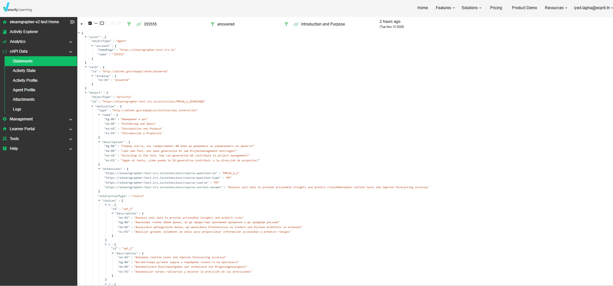
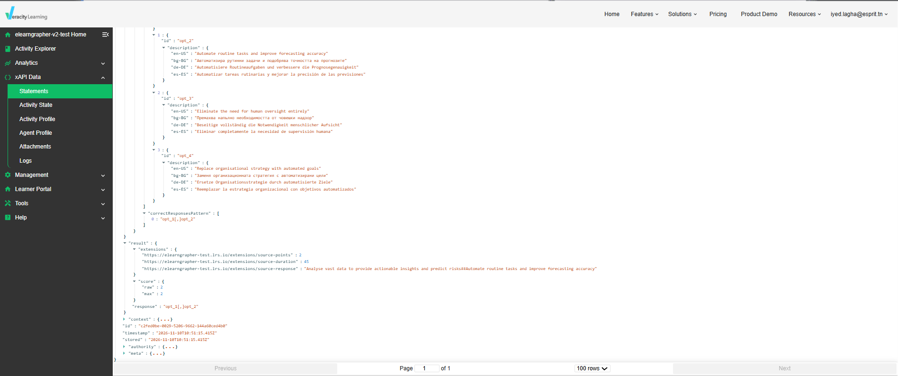

# eLearnGrapher — SQLite to xAPI

### Learning Activity Extraction, xAPI Conversion & Veracity LRS Integration

This project was developed as part of the **eLearnGrapher** project at **Hochschule Schmalkalden, Germany**, under the supervision of Prof. Kurt Englmeier.

The objective is to transform learner activity data from SQLite into enriched **xAPI statements**, enabling standardized learning activity tracking and integration with a Learning Record Store (LRS).

## 1. Project Architecture


**SQLite Database → Python Conversion → xAPI JSON → Validation → Veracity LRS**

The pipeline extracts learner actions, enriches them with educational metadata, validates the generated statements, and supports their storage and retrieval through Veracity Learning.

## 2. V2 Improvements

Compared with the initial implementation, V2 introduces:

- Complete question descriptions instead of question IDs only.
- Multilingual content in English, German, Spanish, and Bulgarian.
- Question types, answer choices, and correct answer patterns.
- Recorded learner responses and achieved scores.
- Course, chapter, and learning module context.
- Source-data preservation using xAPI extensions.
- Independent SQLite auditing and local xAPI validation.
- Batch upload and statement retrieval through Veracity LRS.

The xAPI structure follows standard conventions and references the [Tin Can API Registry](https://registry.tincanapi.com/).

## 3. Results

| Metric | Result |
|--------|--------|
| Total learner actions | 430 |
| Pages experienced | 299 |
| Questions answered | 131 |
| Single-choice questions | 46 |
| Multiple-choice questions | 45 |
| Short-answer questions | 40 |
| Available learner responses | 3 |
| Contextualized statements | 430 |
| SQLite audit errors | 0 |
| Local xAPI validation errors | 0 |
| Statements uploaded to Veracity V2 | 430 |
| Statements retrieved and verified | 44 |

All 430 statements passed the implemented local validation checks and were accepted by the Veracity test LRS.

## 4. Veracity LRS — V2 Demonstration

The following screenshots demonstrate the enriched xAPI statements stored in Veracity Learning.

### 4.1 Question Description and Answer Choices

The xAPI statement contains:

- Learner identification (`actor`).
- Learning action (`verb`).
- Complete question description (`object.definition.description`).
- Multilingual question content.
- Question type (`interactionType`).
- Available answer choices (`choices`).



### 4.2 Learner Response and Score

The statement also records:

- The expected correct answer (`correctResponsesPattern`).
- The learner's actual response (`result.response`).
- The achieved score (`result.score`).
- Additional original data in xAPI extensions.

**Example:**

| Field | Value |
|-------|-------|
| Question | How can generative AI contribute to project management? |
| Interaction type | choice |
| Correct answer | `opt_1[,]opt_2` |
| Learner response | `opt_1[,]opt_2` |
| Score | 2/2 |



This demonstrates that another platform can retrieve meaningful question details, recorded learner responses, and scores from the LRS.

## 5. Project Structure

```text
eLearnGrapher_xAPI/
├── images/
│   ├── pipeline-architecture.png
│   ├── 4.png
│   └── 5.png
├── v2/
│   ├── main_v2.py
│   ├── audit_v2.py
│   ├── validate_xapi_v2.py
│   └── upload_v2.py
├── main.py
├── validate_xapi.py
├── test_lrs.py
├── upload_xapi.py
├── README.md
└── .gitignore
```

## 6. Run V2

**Requirements:** Python 3.12 or a compatible Python 3 version.

Place the authorized `test.sqlite` database in the project root.

### Step 1 — Convert SQLite Data to xAPI

```bash
python v2/main_v2.py --base-iri https://elearngrapher-test.lrs.io
```

Generates `v2/xapi_statements_v2.json`.

### Step 2 — Audit Source Data

```bash
python v2/audit_v2.py
```

Checks the fidelity of exported statements against the SQLite records.

### Step 3 — Validate xAPI Statements

```bash
python v2/validate_xapi_v2.py
```

Performs local structural and semantic validation.

### Step 4 — Preview the LRS Upload

```bash
python v2/upload_v2.py
```

The uploader runs in dry-run mode by default.

Actual uploads require an authorized LRS endpoint, credentials, and explicit confirmation.

## 7. xAPI Statement Structure

| xAPI Field | Description |
|------------|-------------|
| `actor` | Identifies the learner |
| `verb` | Describes the learning action |
| `object` | Identifies the learning activity |
| `definition.description` | Complete question text |
| `interactionType` | Question interaction type |
| `choices` | Available answer options |
| `correctResponsesPattern` | Expected correct answer |
| `result.response` | Recorded learner response |
| `result.score` | Achieved and maximum points |
| `context` | Course, chapter, and learning module |
| `extensions` | Additional original source information |

## 8. Known Limitations

- 128 question events have no learner response in the supplied database.
- Original action timestamps require source timezone confirmation.
- Duration values require unit confirmation.
- Full xAPI conformance testing and automated LMS synchronization remain future work.

Missing learner responses are not artificially generated.

## 9. Data Privacy

Learner databases, exported learner records, and LRS credentials must not be published in this public repository.

Public screenshots should not expose learner identifiers or personal contact information.

## 10. Author

**Mohamed Iyed Lagha**

Artificial Intelligence Engineering Intern

**Hochschule Schmalkalden — Germany**
