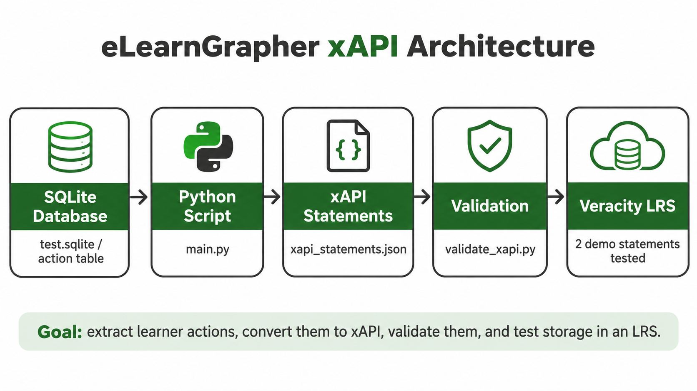
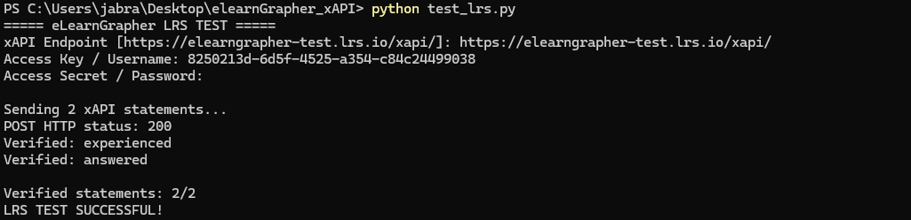
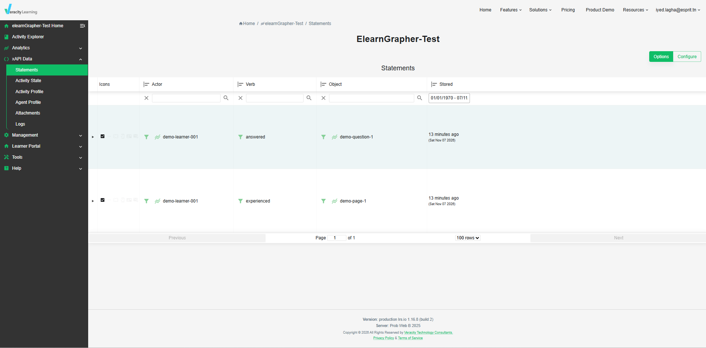

# eLearnGrapher — SQLite to xAPI Pipeline

### Learning Activity Extraction, xAPI Conversion, Validation & LRS Testing

This project was developed as part of my Artificial Intelligence Engineering internship work on **eLearnGrapher** at **Hochschule Schmalkalden, Germany**.

The objective is to extract learner activities from a SQLite database, convert them into standardized **Experience API (xAPI)** statements, and validate the generated data.

An additional proof of concept demonstrates successful communication with a real **Learning Record Store (LRS)** using Veracity Learning.

---

## 1. Project Architecture



### Workflow

**SQLite Database → Python Conversion → xAPI JSON → Validation → Optional LRS Test**

1. **SQLite Database:** Stores learner interactions.
2. **Python Conversion:** Extracts and transforms learning actions.
3. **xAPI Statements:** Represents actions in standardized JSON format.
4. **Validation:** Checks the generated statements.
5. **Veracity LRS:** Demonstrates storage and retrieval using synthetic events.

---

## 2. Project Objectives

The main objectives are to:

- Extract learner actions from the SQLite database.
- Process page visits and question interactions.
- Convert the actions into xAPI statements.
- Preserve available duration, answer, and score information.
- Validate the generated xAPI statements.
- Test communication with an xAPI-compatible LRS.

---

## 3. Repository Structure

```text
eLearnGrapher_xAPI/
│
├── main.py
├── validate_xapi.py
├── test_lrs.py
├── upload_xapi.py
├── README.md
├── .gitignore
│
└── images/
    ├── pipeline-architecture.png
    ├── veracity-dashboard.png
    └── veracity-test-terminal.png
```

### Private Data Files

The following files are used locally but should not be included in the public GitHub repository:

```text
test.sqlite
xapi_statements.json
```

The original database and generated export may contain learner-related information.

---

## 4. Technologies Used

| Technology | Purpose |
|------------|---------|
| Python | Data extraction and conversion |
| SQLite | Source database |
| JSON | xAPI statement representation |
| xAPI | Learning activity data standard |
| Veracity Learning | LRS testing |
| HTTP REST API | LRS communication |

The implemented Python scripts use standard-library modules.

---

## 5. Source Database

The project processes the `action` table from `test.sqlite`.

### Database Fields

| Column | Description |
|--------|-------------|
| `learnerID` | Learner identifier |
| `objectID` | Learning activity identifier |
| `endtime` | End time of the recorded activity |
| `duration` | Time spent on the activity |
| `statement` | Learner's response, when available |
| `points` | Points achieved |

### Activity Classification

The conversion script distinguishes two types of learning actions:

| Object ID Suffix | xAPI Verb | Meaning |
|------------------|-----------|---------|
| `::TX` | `experienced` | Learner studied a page |
| `::QS` | `answered` | Learner interacted with a question |

---

## 6. SQLite to xAPI Conversion

The main conversion script is:

```bash
python main.py
```

### Processing Steps

1. Connect to the SQLite database.
2. Extract records from the `action` table.
3. Identify the type of learning activity.
4. Generate an xAPI statement for each action.
5. Map available data to xAPI properties.
6. Save the result as `xapi_statements.json`.

### Data Mapping

| SQLite Data | xAPI Field |
|-------------|------------|
| `learnerID` | `actor.account.name` |
| Activity type | `verb.id` |
| `objectID` | `object.id` |
| `duration` | `result.duration` |
| `statement` | `result.response` |
| `points` | `result.score.raw` |

Each source action is assigned a deterministic UUID-based statement identifier.

### Conversion Results

```text
===== xAPI EXPORT SUMMARY =====

Total actions: 430
Pages experienced: 299
Questions answered: 131
Answers available: 3
Unique IDs: 430
```

**Result:** 430 learner actions were successfully converted into xAPI statements.

---

## 7. xAPI Validation

The generated xAPI statements are validated using:

```bash
python validate_xapi.py
```

### Validation Checks

- JSON structure.
- Required statement properties.
- Unique statement identifiers.
- Actor structure.
- Verb and activity identifiers.
- Basic result-field structure.

### Validation Results

```text
Total statements: 430
Unique IDs: 430

Verbs:
{'experienced': 299, 'answered': 131}

Basic validation errors: 0

Basic validation passed
```

The validator performs basic structural checks, not a full xAPI specification conformance assessment.

---

## 8. Veracity LRS Integration Test

To demonstrate the storage of xAPI statements in a real Learning Record Store, the project was tested using **Veracity Learning LRS**.

### Test Script

```bash
python test_lrs.py
```

This script:

1. Connects to the configured Veracity LRS.
2. Generates two synthetic xAPI statements.
3. Sends them through the xAPI REST API.
4. Retrieves the statements to verify successful storage.

### Synthetic Test Events

| Verb | Activity | Duration |
|------|----------|----------|
| `experienced` | `demo-page-1` | 31 seconds |
| `answered` | `demo-question-1` | 45 seconds |

The `answered` event also includes a demonstration response and score.

### Terminal Test Result



```text
===== eLearnGrapher LRS TEST =====

Sending 2 xAPI statements...

POST HTTP status: 200

Verified: experienced
Verified: answered

Verified statements: 2/2

LRS TEST SUCCESSFUL!
```

### Veracity Dashboard



The Veracity dashboard confirms the successful storage of both demonstration events.

| Actor | Verb | Activity |
|-------|------|----------|
| `demo-learner-001` | `experienced` | `demo-page-1` |
| `demo-learner-001` | `answered` | `demo-question-1` |

**Important:** Only two synthetic statements were transmitted during this test. No real learner records were uploaded to Veracity.

---

## 9. Optional Batch Upload

The project also includes an optional script:

```text
upload_xapi.py
```

Its purpose is to support batch uploads of xAPI statements to an LRS.

### Preview Mode

```bash
python upload_xapi.py
```

The default command checks the local JSON data without transmitting it.

### Preview Results

```text
===== eLearnGrapher xAPI UPLOAD =====

Available events: 430
Selected events: 430

Verbs:
{'experienced': 299, 'answered': 131}

Without timestamp: 430
Questions without response: 128
Temporary activity IDs: 430

PREVIEW ONLY: No data sent.
```

Actual uploads are optional and require appropriate authorization for handling learner data.

---

## 10. Results Summary

| Metric | Result |
|--------|--------|
| Total extracted actions | 430 |
| xAPI statements generated | 430 |
| Page interactions | 299 |
| Question interactions | 131 |
| Responses available | 3 |
| Unique statement IDs | 430 |
| Basic validation errors | 0 |
| Synthetic LRS events sent | 2 |
| Synthetic LRS events verified | 2 |
| Real learner events uploaded to Veracity | 0 |

---

## 11. Known Limitations

### 11.1 Timestamps

The original timestamps are currently omitted from the exported xAPI statements because the source timezone has not been confirmed.

### 11.2 Missing Responses

Among the 131 `answered` events, 128 have no response text available.

The script does not generate artificial answers for missing source values.

### 11.3 Temporary Activity Identifiers

The current prototype uses temporary activity identifiers under:

```text
https://example.org/elearnGrapher
```

These should be replaced by permanent project-specific identifiers before production deployment.

### 11.4 Duration Unit

Duration values are currently interpreted as seconds.

The original measurement unit should be confirmed with the project supervisor.

### 11.5 Validation Scope

The current validation script performs basic structural checks.

Additional specification-level testing would be needed for production integration.

---

## 12. Future Improvements

Potential future work includes:

- Confirming source timestamps and timezone.
- Verifying the duration unit.
- Replacing temporary activity identifiers.
- Improving the representation of question interactions.
- Extending xAPI validation.
- Integrating the pipeline with an approved LMS/LRS.
- Automating learning event synchronization.
- Developing a monitoring and analysis dashboard.

---

## 13. Installation and Usage

### Prerequisites

- Python 3.12 or compatible Python 3 version.
- SQLite test database supplied by the project team.
- A terminal or development environment such as VS Code.

### Step 1 — Clone the Repository

```bash
git clone https://github.com/YOUR_USERNAME/eLearnGrapher_xAPI.git
cd eLearnGrapher_xAPI
```

Replace `YOUR_USERNAME` with the actual GitHub account name after creating the repository.

### Step 2 — Add the Local Database

Place the authorized `test.sqlite` database in the project directory.

The original database is not distributed through the public repository.

### Step 3 — Run the Conversion

```bash
python main.py
```

### Step 4 — Validate the Output

```bash
python validate_xapi.py
```

### Step 5 — Test the LRS

```bash
python test_lrs.py
```

The LRS test requires an endpoint and credentials for an accessible LRS.

API secrets are entered through the terminal and should never be committed to GitHub.

---

## 14. Data Privacy and Security

The project is based on learner interaction data provided for internship work.

To protect the source information:

- Do not publish the original SQLite database.
- Do not commit exported real learner records.
- Do not expose API keys or passwords.
- Remove credentials and personal information from screenshots.
- Obtain authorization before transferring real learner data to an external service.
- Obtain the project supervisor's approval before publicly releasing internship deliverables.

The public documentation demonstrates the workflow using aggregate results and synthetic LRS test events.

---

## 15. Project Status

### Completed

- [x] SQLite action extraction.
- [x] Conversion to xAPI statements.
- [x] Generation of 430 xAPI records.
- [x] Basic xAPI validation.
- [x] Successful communication with Veracity LRS.
- [x] Synthetic statement storage and retrieval verification.

### Future Work

- [ ] Confirm timestamp timezone.
- [ ] Confirm duration units.
- [ ] Define permanent activity identifiers.
- [ ] Extend xAPI conformance validation.
- [ ] Explore LMS/LRS integration requirements.

---

## 16. Author

**Mohamed Iyed Lagha**

Artificial Intelligence Engineering Student  
AI Research & Development Intern

**Hochschule Schmalkalden — Germany**

---

## 17. Acknowledgments

This prototype was developed in the context of the eLearnGrapher project under the academic guidance of Professor Kurt Englmeier and the project team at Hochschule Schmalkalden.
